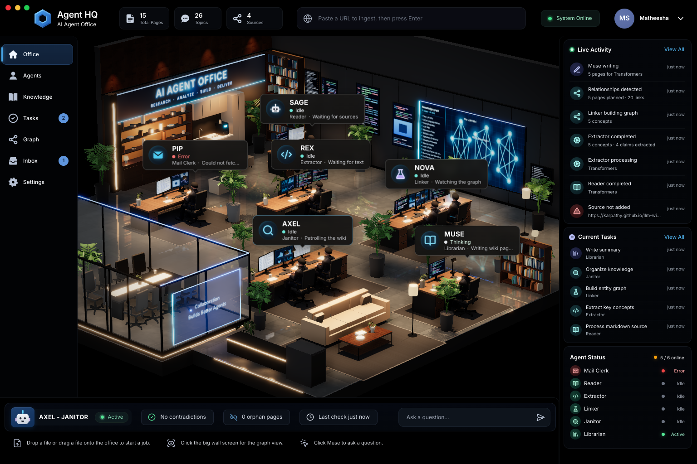

# Agent HQ

A desktop app (Electron) for a second brain built on the **LLM Wiki** pattern. You drop sources in, and a team of six agents reads them, writes and links markdown wiki pages, answers questions from those pages, and checks the wiki for problems. You watch the work happen in a 3D office.



## What it does

- **Inbox:** drop files anywhere on the window, paste a URL into the top bar, or write a note. Each source is copied untouched into `raw/`.
- **Ingest:** five agents process each source with the Claude API:
  - **Pip** (Mail Clerk) files it.
  - **Sage** (Reader) summarises it; PDFs and images are sent to Claude as they are.
  - **Rex** (Extractor) pulls out concepts and claims.
  - **Nova** (Linker) plans which pages to create or update.
  - **Muse** (Librarian) writes the pages into `wiki/`, refreshes `index.md` and appends to `log.md`.
- **Janitor:** **Axel** checks the wiki after every ingest. It finds orphan pages (by code) and contradictions (with Claude). Results show in the bottom bar.
- **Ask:** type a question in the bottom bar. Muse answers only from your wiki pages and cites them; click a citation to open the page.
- **Views:** Office (the live 3D office), Agents, Knowledge (searchable page reader), Tasks, Graph (interactive map of `[[links]]`), Inbox and Settings.

The office, the side panels and the counters all show the real state of your knowledge folder. Nothing is sample data.

## Run it

Requires Node.js 20+.

```bash
npm install
npm run dev        # development, with hot reload
npm run build      # production build into out/
npm run preview    # run the production build
npm run dist       # unpacked app in dist/ (electron-builder --dir)
```

### Windows installer

```bash
npx electron-builder --win nsis --x64 -c.win.signAndEditExecutable=false -c.nsis.oneClick=false -c.nsis.allowToChangeInstallationDirectory=true -c.nsis.perMachine=false
```

This writes `dist/AgentHQ-Setup-0.1.0.exe`. On Linux the build needs Wine (`wine`, `wine64`, `wine32:i386`). The installer installs for the current user only (no admin rights), lets you pick the folder, and adds Start-menu and Desktop shortcuts. It is not code-signed, so Windows SmartScreen shows "Windows protected your PC": choose **More info**, then **Run anyway**.

Once the app is running (from `npm run dev` or the installer), open **Settings** and:
1. Paste your **Claude API key**. It is stored on your computer, encrypted with your OS keychain where available, and only ever sent to the Claude API. You can also set `ANTHROPIC_API_KEY` in your environment instead.
2. Optionally choose your **knowledge folder**. The default is `Documents/Agent HQ Knowledge`.

Without a key, everything works except ingest, Ask and the contradiction check, which say "Add your Claude API key in Settings".

The default model is `claude-opus-5-5` (changeable in Settings). Requests use structured outputs, and `fallbacks: "default"`, so a request Claude declines is re-run on Anthropic's recommended fallback model instead of failing.

## The knowledge folder

```
Agent HQ Knowledge/
  raw/            untouched copies of everything you add
  wiki/           markdown pages with YAML front matter and [[wikilinks]]
  index.md        catalogue of pages (regenerated)
  log.md          append-only record of ingests
  sources.json    inbox state
  janitor.json    last janitor report
```

It's plain markdown, so you can open it in Obsidian or any editor. Edits you make outside the app are picked up.

## Project layout

```
src/shared/types.ts        contract between main process, preload and UI
src/main/engine/           LLM Wiki engine (no Electron imports in the core), IPC
src/preload/               window.api bridge
src/renderer/src/ui/       window chrome, panels and views
src/renderer/src/office/   the 3D office (react-three-fiber)
resources/                 bundled models and textures (see CREDITS.md)
scripts/                   test stand-in for the Claude API, tests and screenshot tools
```

## Tests

```bash
node scripts/engine-test/run.mjs          # engine tests against a local stand-in for the Claude API
npm run build
xvfb-run -a node scripts/ui-e2e.mjs       # clicks through the real app (Linux; drop xvfb-run elsewhere)
xvfb-run -a node scripts/scenario-shot.mjs .shots/app.png
python3 scripts/compare.py .shots/app.png .shots/compare.png   # side by side with docs/reference.png
```

`scripts/fake-claude.mjs` emulates the Claude Messages API so the whole pipeline can be tested offline. Its answers are simple rules, not real model output.

## Credits

Third-party models, textures and fonts are listed in [CREDITS.md](CREDITS.md).
